<div align="center">

# 🏝️ QR Island

**Make beautiful QR codes in seconds. Free, private, no sign-up.**

[**Open the app →**](https://shehan17.github.io/QR-Island/)

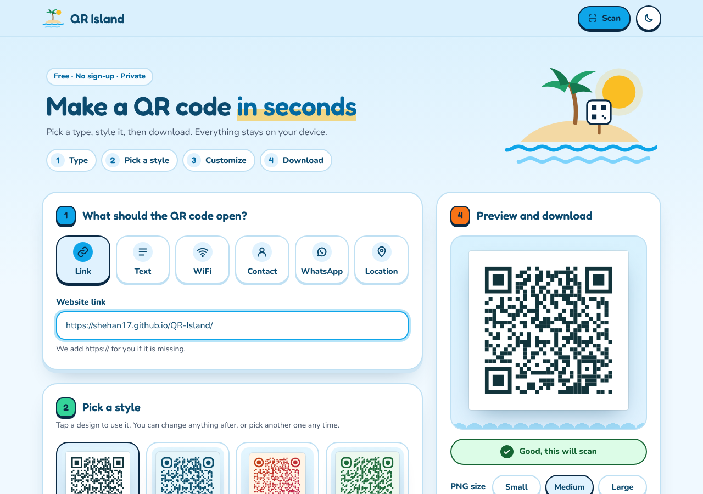

</div>

---

### 🤔 What is this?

QR Island is a free website that makes QR codes.

A QR code is a square picture that phones can scan. When someone scans it, their phone opens a link, joins a WiFi network, saves a contact, and more.

With QR Island you can:

1. **Type** what the QR code should open (for example, a website link)
2. **Pick a style** you like
3. **Change** the colors, shapes, logo or text if you want
4. **Download** it and use it anywhere: posters, menus, business cards, social media

You don't need to make an account. Your data stays on your phone or computer.

### 📱 Try it: scan one of these

Every QR code below was made with QR Island. They all open our site:
**https://shehan17.github.io/QR-Island/**

<table>
  <tr>
    <td align="center"><br><b>Classic</b></td>
    <td align="center">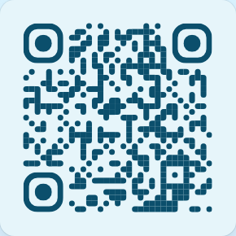<br><b>Ocean</b></td>
    <td align="center">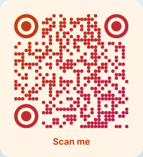<br><b>Sunset</b></td>
    <td align="center">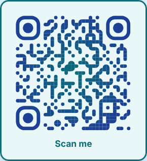<br><b>Lagoon</b></td>
  </tr>
  <tr>
    <td align="center">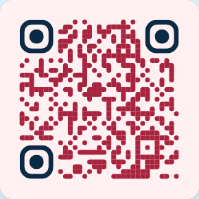<br><b>Coral Reef</b></td>
    <td align="center">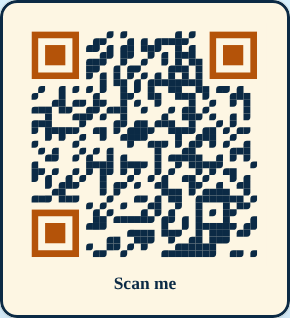<br><b>Golden Hour</b></td>
    <td align="center">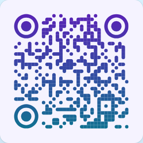<br><b>Bubble</b></td>
    <td align="center">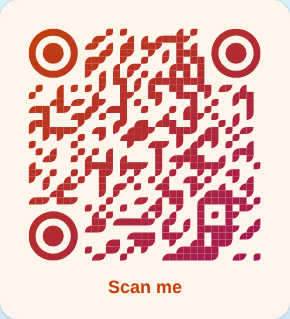<br><b>Tropical</b></td>
  </tr>
</table>

### 🖼️ Screenshots

**Pick a style:** you see your own QR code in every design. Tap one to use it.

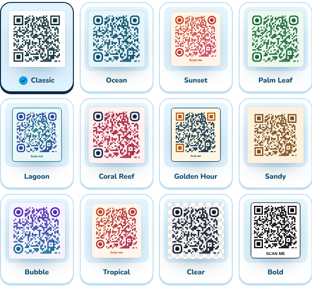

**On your phone:** works great on small screens, in light and dark mode.

<p>
  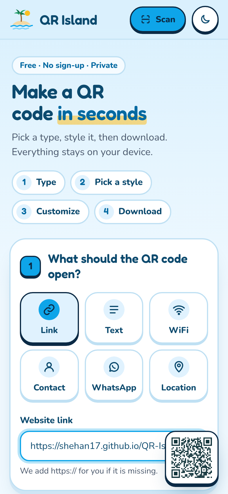
  &nbsp;
  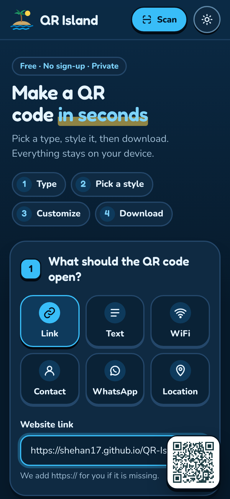
</p>

### ✨ What you can do

- 🔗 **6 kinds of QR code:** Link, Text, WiFi, Contact, WhatsApp, Location
- 🏝️ **12 ready-made styles** to start from
- 🎨 **Colors:** one color or a gradient, plus a see-through background
- 🔵 **Shapes:** 6 dot shapes and different corner styles
- 🖼️ **Extras:** add your logo, a frame, and text like "Scan me"
- ✅ **Scan check:** tells you if your QR code will scan or not
- 💾 **Download** as PNG (small, medium or large) or SVG, and save codes for later
- 📷 **Scanner:** read any QR code with your camera or from a photo
- 🌙 **Light and dark mode**

### 🔒 Your data is safe

Everything happens inside your browser. Nothing is sent to a server.

### 🛠️ Run it on your computer

It is plain HTML, CSS and JavaScript. Nothing to build.

```sh
npx http-server .
```

Then open the link it shows. When you push to `main`, GitHub Actions puts the site live on GitHub Pages.

---

<div align="center">
Built with <a href="https://github.com/kozakdenys/qr-code-styling">qr-code-styling</a> and <a href="https://github.com/mebjas/html5-qrcode">html5-qrcode</a> · Fonts: Fredoka and Nunito · Made with 🌴
</div>
